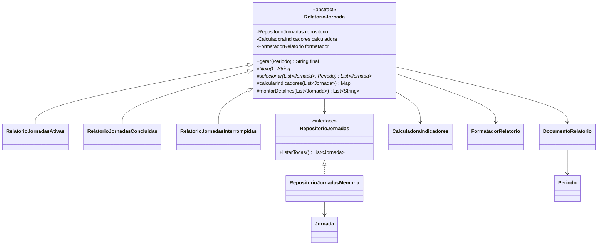
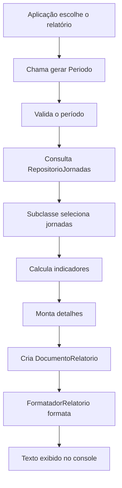

# Diagrama de classes e fluxo

## Responsabilidades e relações

## Sequência do Template Method

## Como explicar o diagrama

- A classe abstrata `RelatorioJornada` contém o método Template Method `gerar(Periodo)`, que é final e retorna uma `String` formatada.
- As três subclasses herdam o fluxo e definem título e seleção. O relatório de concluídas também especializa o cálculo de indicadores e os detalhes.
- `RepositorioJornadas` é uma interface; `RepositorioJornadasMemoria` fornece os dados fictícios.
- `CalculadoraIndicadores` e `FormatadorRelatorio` são colaboradores recebidos pela classe-base.
- `Jornada`, `Periodo` e `DocumentoRelatorio` representam dados de entrada, recorte temporal e saída estruturada.

## Atenção à distinção entre algoritmo e resultado

O Template Method não significa que todos os relatórios produzem o mesmo conteúdo. Significa que a sequência de geração é definida em um único lugar. As subclasses preenchem os pontos de variação previstos pela classe-base.
